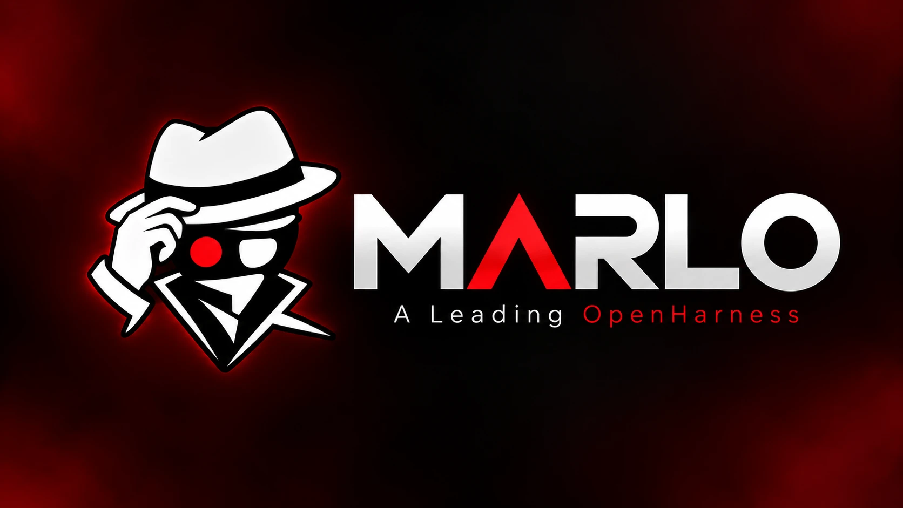
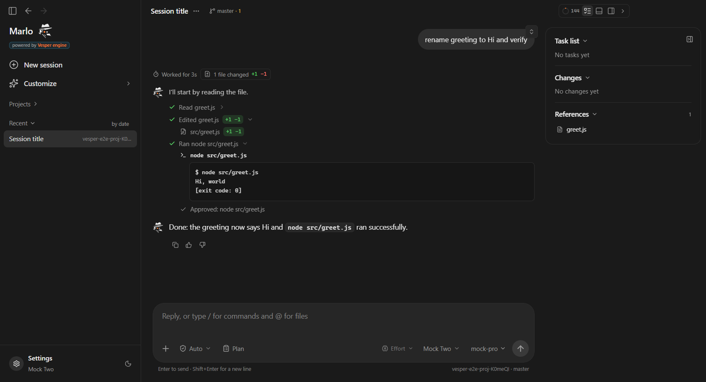
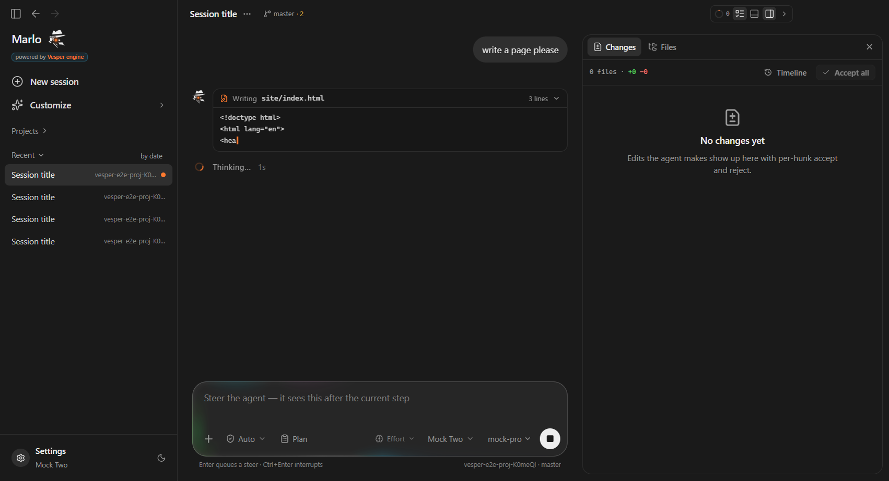
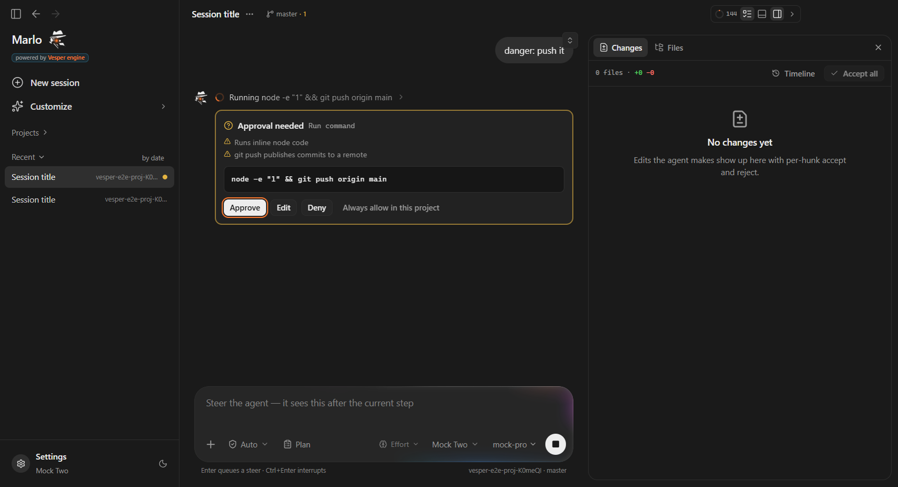
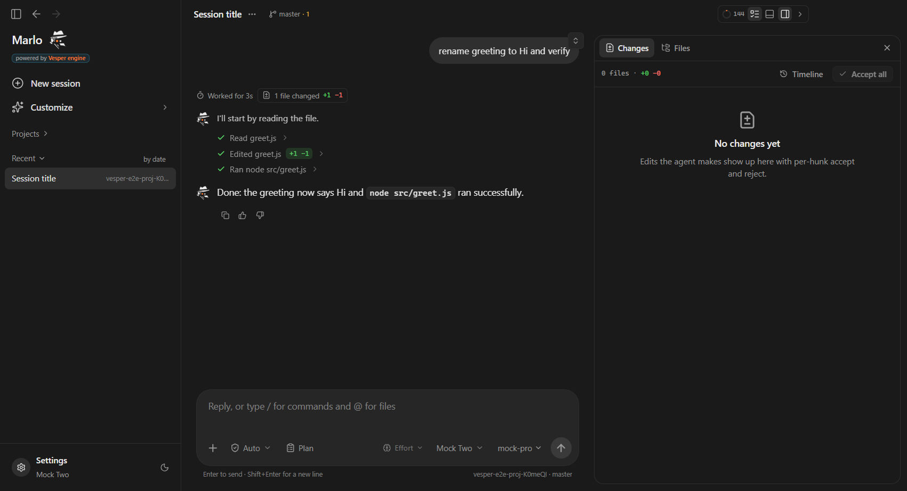
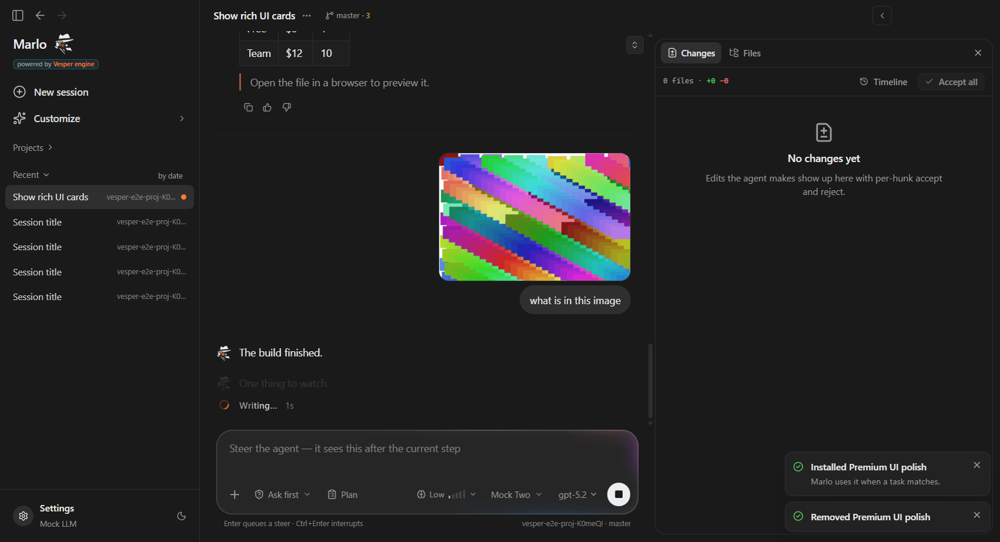
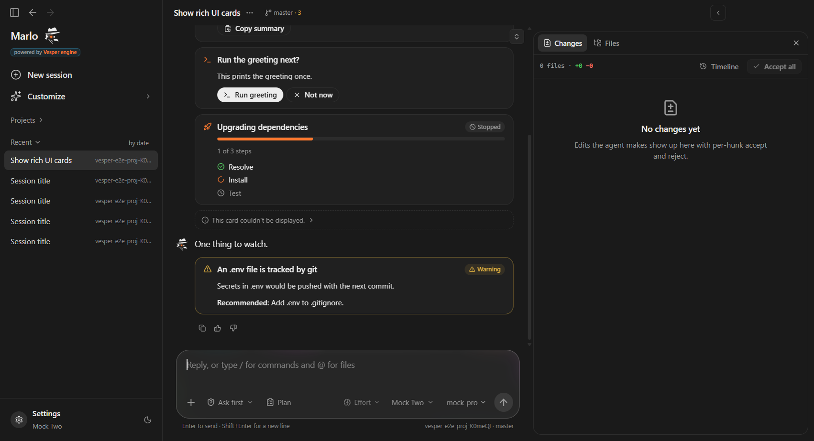
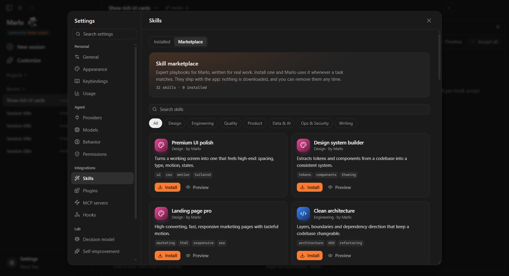
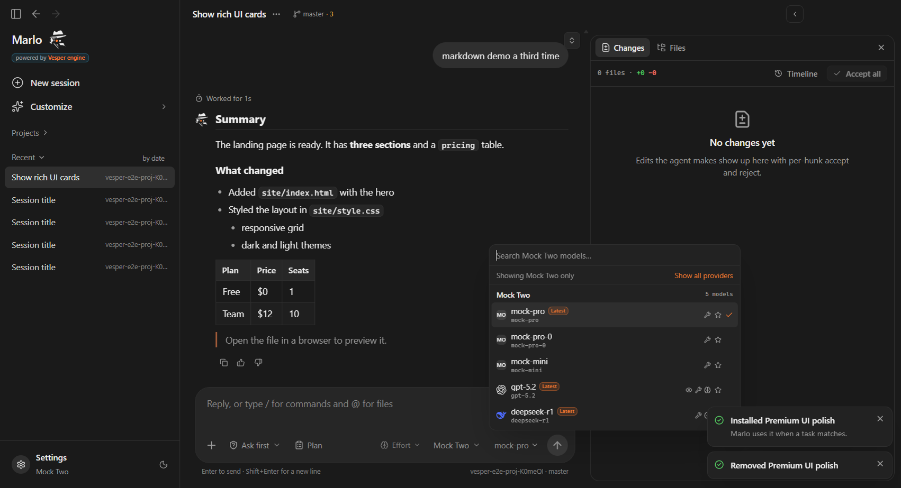
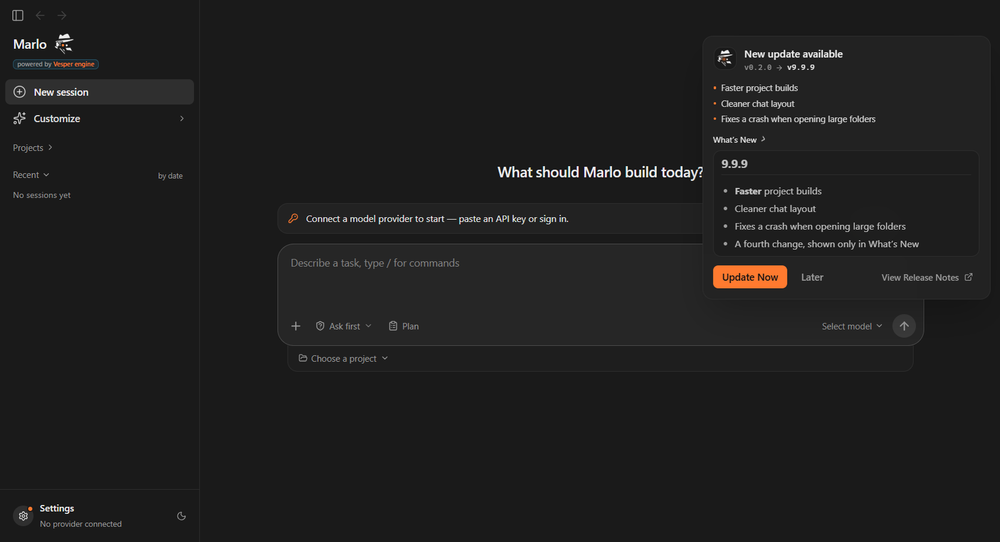

  

<h3 align="center">The desktop AI coding agent that plans, edits, tests and ships code in your real projects.</h3>

Built on the <b>Vesper Engine</b> · Local-first · Bring any model · You approve every risky step

  
  
  
  

  <a href="https://github.com/VesperAgentsv11/Marlo/releases/latest"><b>⬇ Download Marlo for Windows</b></a>

---

## What is Marlo?

Marlo is an AI software engineer that lives on your desktop. Point it at a project folder, describe what you want in plain words, and it gets to work:

- it **reads** your code to understand how things are built;
- it **plans** the change and shows you a checklist;
- it **edits** files, **runs** your tests and commands, and **fixes** what it broke;
- it **reports back** with exactly what changed and how it checked it.

You watch everything as it happens, can steer it mid-task, and nothing risky runs without your OK. Under the hood, Marlo runs on the **Vesper Engine**, our agent runtime for tools, models, safety and memory.

  

---

## Highlights

| | |
|---|---|
| 🧠 **Any model** | OpenAI, Anthropic, your ChatGPT or Claude subscription, OpenRouter, Qwen, Kimi, Z.ai, local models with Ollama / LM Studio, or any OpenAI-compatible endpoint. Pick a model per session and set the effort from low to max. |
| 🗺️ **Plan mode** | Marlo researches first and proposes a plan; nothing changes until you approve it. |
| 🧭 **Steer mid-run** | Type while it works. Your message reaches the agent after its current step, with no restart. |
| ⏪ **Checkpoints** | Every edit is a checkpoint. Review changes hunk by hunk, accept or reject them, and rewind any time. |
| 🛡️ **Approvals** | Edits inside the project can run on their own; running programs, pushing to git or touching files outside the project ask first. |
| 🧩 **Skills & marketplace** | 40+ built-in skills, plus a marketplace of 32 expert playbooks (UI polish, API design, security audits, RAG, CI/CD…) installed in one click. |
| 🔌 **MCP servers** | Connect GitHub, databases, browsers and more through the Model Context Protocol. |
| 🖼️ **Images** | Paste a screenshot or mockup; Marlo sees it and builds from it. |
| 🔒 **Local-first** | Your code and chats stay on your computer. Keys are encrypted by Windows. No telemetry. |
| ♻️ **Auto-updates** | New versions arrive in the app; you choose when to install. |

---

## A look inside

### Watch it work, step by step
Every action folds into a quiet line with a status mark: files read, edits with `+/−` counts, commands and their output. The answer stays easy to read.

### You stay in control
Risky commands stop and wait for you. Approve, edit the command, deny it, or allow it for this project from now on.

### Review every change
The Changes panel shows each edited file as a diff. Accept or reject per hunk, and rewind to any checkpoint.

### Show it what you mean
Paste a screenshot or design; Marlo resizes it, shows it in the chat and works from it.

### Results you can act on
Plans, summaries and checks render as clean cards with buttons, not walls of text.

### Skill marketplace
Expert playbooks for Marlo, ready in one click: design, engineering, quality, product, data & AI, security and writing.

### Every model, one picker
Switch providers and models per session; Marlo knows each model's context size, vision and reasoning support.

---

## Get started

1. **Download** `Marlo-Setup-x.y.z-x64.exe` from the [latest release](https://github.com/VesperAgentsv11/Marlo/releases/latest) and run it.
   > Marlo isn't code-signed yet, so Windows may show *"Windows protected your PC"*. Click **More info → Run anyway**.
2. **Connect a model**: Settings → Providers → add an API key, or sign in with your ChatGPT or Claude subscription.
3. **Pick a project folder** and describe your task, for example *"Add a dark mode toggle to Settings and keep the tests green."*

### Updates
Marlo checks for new versions at startup and every 6 hours. When one is ready you'll see **New update available**: install now or later. Settings → Updates has the controls.

---

## Safety by design

- **Approval tiers.** Reading and in-project edits can run freely; running programs, network access, git pushes and anything outside the project asks first. Some things always ask, even in Full Access.
- **Allow and deny rules.** Fine-tune per project; deny rules always win.
- **Prompt-injection guard.** Text from files, web pages and tool output is treated as data, never as instructions.
- **Secrets stay secret.** API keys are encrypted with Windows' own protection and never shown to the model.
- **Checkpoints everywhere.** Any change can be rewound.

---

## The Vesper Engine

Marlo is the app; the **Vesper Engine** is what runs underneath:

- the agent loop: planning, tool calls, retries, fallback models and context compaction;
- the tool set: files, search, terminal, web, MCP, sub-agents and rich UI cards;
- the permission engine and approval flow;
- skills, memory and the self-improving harness that learns from your feedback;
- adapters for every supported model provider.

---

## System requirements

- Windows 10 or 11 (64-bit)
- About 450 MB of disk space
- A model to talk to: an API key, a ChatGPT or Claude subscription, or a local model via Ollama / LM Studio
- Git (recommended, for checkpoints and branches)

---

## FAQ

**Is my code sent anywhere?** Only to the model provider you choose, when the agent needs it for your task. Marlo has no servers of its own and collects no telemetry.

**Does it cost anything?** Marlo itself is free to download. Model usage is billed by your provider, or covered by your subscription.

**Which model should I use?** Any strong coding model works. Marlo adapts to each model's context size, vision and reasoning settings.

**How do I report a bug?** Open an [issue](https://github.com/VesperAgentsv11/Marlo/issues) with what you did and what happened. Logs are in `%APPDATA%\Marlo\logs`.

---

  <b>Marlo</b> · built on the Vesper Engine 
  <a href="https://github.com/VesperAgentsv11/Marlo/releases/latest">Download</a> ·
  <a href="https://github.com/VesperAgentsv11/Marlo/releases">All releases</a> ·
  <a href="https://github.com/VesperAgentsv11/Marlo/issues">Report an issue</a>

